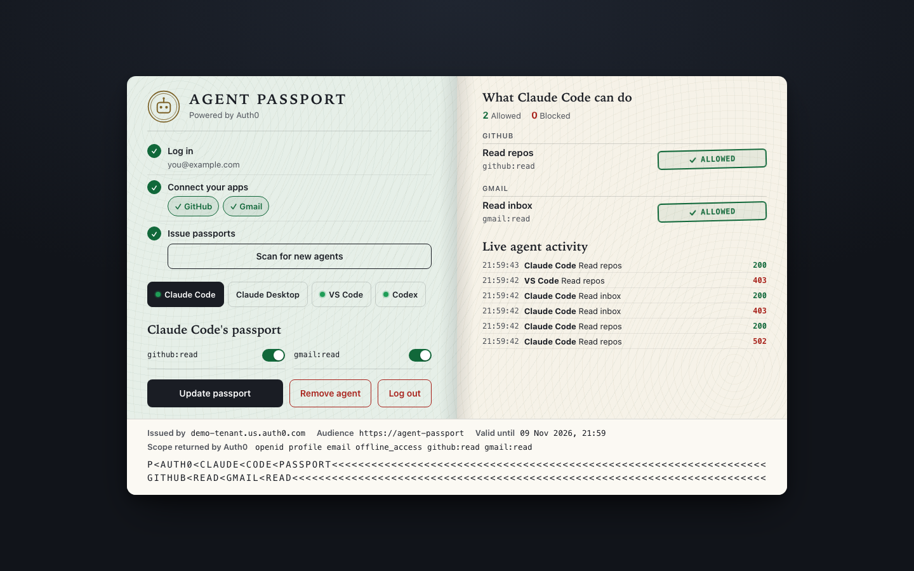

# Agent Passport

Control what each AI agent on your machine can do, from one panel. Auth0 handles login and holds the app credentials, so your agents never see a GitHub or Gmail token.



> **Status:** a local, single-user prototype. The GitHub flow has been run end to end against real Auth0 and GitHub. The Gmail flow is implemented and covered by tests, but hasn't yet been run against a real Google account.

## The problem

When one person runs several agents through one app, Auth0 sees that person and that app. It can't tell the agents apart, so they tend to share the same access.

Agent Passport adds a per-agent layer on top. You log in and connect your apps once. Each agent then gets its own passport, and you can change what it may do at any time, with no code change.

## How it works

```
Claude Code ──┐                                                 ┌─→ GitHub
Claude Desktop┼─→ MCP server ─→ Agent Passport ─→ Auth0 Token ──┤
VS Code ──────┤                 (checks the        Vault        └─→ Gmail
Codex ────────┘                  passport)
```

For every tool call, the panel:

1. **Identifies the agent** from its own key. A caller can't claim to be another agent.
2. **Verifies your Auth0 token:** signature, issuer, audience and expiry.
3. **Checks the scope** is on that agent's passport and in your Auth0 token.
4. **Fetches an app token from Token Vault** and calls the real API, only if everything passed.

A refused call returns a `403` and never contacts the app. The app token stays in the panel and is never sent to the agent.

## What it can do

| Tool | Scope | Returns |
|---|---|---|
| `github_list_repos` | `github:read` | Your 10 most recently updated repos |
| `gmail_list_messages` | `gmail:read` | Sender and subject of your 5 latest emails, never the body |

**One-click passports:** the panel looks for known MCP clients (Claude Code, Claude Desktop, VS Code, Cursor, Windsurf and Codex), gives each its own key, and adds Agent Passport to its config. It backs up any existing config first, leaves your other settings alone, and refuses to touch a config it can't parse.

## Quick start

You'll need Python 3.9+, Node 20.12+, and an Auth0 tenant set up as described in **[docs/setup.md](docs/setup.md)**.

```bash
python3 -m venv venv
source venv/bin/activate
pip install -r requirements.txt
(cd mcp && npm ci)

cp .env.example .env   # then fill in your Auth0 values
python run.py
```

Open `http://localhost:5000`, then follow the three steps on the panel:

1. Log in with Auth0.
2. Connect your apps.
3. Click **Find local agents & issue passports**, then restart each app so it loads its passport.

## Security model

**What it protects**

- App tokens stay in Auth0 and the panel, and never reach an agent.
- The MCP server never reads `.env`, so Auth0 secrets stay out of the agent's process.
- It fails closed: no passport, a bad token, or an unreachable panel all mean no action.
- Other websites can't trigger panel actions, because origin and host are checked.

**Known limits**

- **Local and single-user.** The session is held in memory, shared across the app, and lost on restart. It isn't ready to host.
- **Going through the passport is voluntary.** An agent with its own `gh` login or API token can go around it.
- **Local keys aren't strong identity.** Anything running as your user could read `passports.json`.
- **Removing access doesn't revoke a token already issued.** The passport check applies on the next call, but the Auth0 token stays valid until it expires.
- **Passports live in this app, not in Auth0.** A production version would move agent identity to [Agent as Principal](https://auth0.com/docs/ai-agents-mcp/agent-as-principal) and the rules to Auth0 FGA.
- **Detection only finds known clients.** Custom agents won't appear, and "running" is a best guess from process names.

The setup also turns off refresh token rotation and the My Account API's 2FA policy, because this flow needs them off. Keep the 2FA policy on in production, with a step-up prompt when someone connects an account.

## Project layout

```
agent_passport/      The panel
  app.py             Routes, passport decisions, Token Vault and app calls
  agents.py          Finds local agents, issues keys, edits their configs
  auth.py            Auth0 SDK setup
  templates/ static/ The UI
mcp/server.mjs       MCP server each agent runs. It only forwards calls.
tests/               Python tests
docs/setup.md        Auth0 and GitHub setup, plus troubleshooting
run.py               Starts the panel
```

## Tests

No Auth0 account or network is needed. Tokens are real RS256 JWTs checked by the real verifier, and only the network edges are faked. Every client path points to a temporary folder, so tests can't touch your real app configs.

```bash
pip install -r requirements-dev.txt
pytest
(cd mcp && npm test)
```

## Roadmap

- Human approval for risky actions, using Auth0 Asynchronous Authorization (CIBA)
- More read-only actions and apps
- Agent identity through Agent as Principal
- Hosted version with per-user sessions and an `npx` connector
